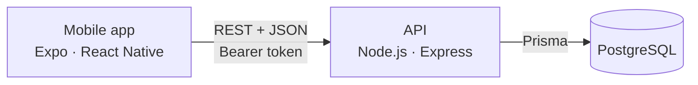

# Viewmaster

**Equipment inventory & logistics for event production.**

Storages, vehicles, venues and events — one shared picture of where every piece of gear is, who moved it and when.

> Mobile app (Expo / React Native). The interface is in Greek.
> Backend → [Viewmaster-backend](https://github.com/DrThanosNT/Viewmaster-backend)

---

## Overview

Viewmaster replaces "who has the cables?" phone calls with a live record of your equipment.

Stock lives in **locations** (storages, vehicles, venues). Every time something moves, is borrowed, breaks, gets repaired or is used up, the person doing it records it in a few taps. The app keeps the counts right and writes a permanent log entry with the name of whoever did it.

Events sit on top of this: an event groups one or more venues, and its view shows only the gear that was sent *for that event* — while a storage always shows everything physically inside it.

## Screenshots

<table>
  <tr>
    <td align="center"><br><sub><b>Overview</b><br>pending borrowed items, recent activity</sub></td>
    <td align="center"><br><sub><b>Stock</b><br>move, import, consume, return, damage, repair</sub></td>
    <td align="center"><br><sub><b>Locations</b><br>everything inside a storage</sub></td>
  </tr>
  <tr>
    <td align="center"><br><sub><b>Events</b><br>venues and gear sent for the event</sub></td>
    <td align="center"><br><sub><b>Borrowed items</b><br>return dates, overdue flagged</sub></td>
    <td align="center"><br><sub><b>Logs</b><br>who moved what, where and when</sub></td>
  </tr>
</table>

## Features

### Locations

Three kinds: **storage**, **vehicle** and **other** (venues, sites). Each location shows exactly what is in it right now, split into usable, damaged and borrowed quantities. Locations can only be deleted once they are empty.

### Stock movements

Every action works on a *cart*: add as many lines as you need, add one note, submit once. A cart becomes one grouped entry in the logs.

| Action | Greek label | What it does |
|---|---|---|
| Transport | Μεταφορά | Moves stock from one location to another (or to a venue *as part of an event*) |
| Import | Εισαγωγή | Brings new stock in — or borrowed stock, with an optional return date |
| Consume | Κατανάλωση | Takes stock out for good (also works on damaged stock) |
| Return | Επιστροφή | Sends borrowed stock back |
| Damage | Ζημιά | Moves usable units into the damaged pool |
| Repair | Επισκευή | Moves damaged units back to usable |

Item kinds: **discrete** (cables, lights, tables) and **consumable** (bolts, tape, cable ties).

### Events

An event has a name, a time period and one or more venues (storages can't be added). The destination list in the Stock tab offers every plain location plus one entry per event venue, with the event name shown and the location underneath; events that have finished drop out of the list. Opening an event shows only the gear sent to its venues for that event. An event can only be deleted once nothing is left tagged to it.

### Borrowed items

Borrowed stock keeps its own count and an optional "should be gone by" date. The soonest date wins when several batches sit in the same place. Overdue items are flagged on the Overview and in the location lists.

### Damaged items

Damaged units are tracked separately from usable stock, with the last few damage and repair entries (who, when, how many, note) one tap away.

### Running low

Long-press an item to flag it as running low («Τελειώνει»). The flag clears automatically when new stock is imported there.

### Logs

A searchable history grouped by Today, Yesterday, the last 7 days, the last 30 days and then by month. Each entry shows who did it, what moved, from where, to where, and the note. Names are copied into every entry, so deleting an item, location, event or member never rewrites history.

### Members & roles

| Role | Greek | Can do |
|---|---|---|
| Worker | Εργαζόμενος | Record all stock movements, create and edit items, flag items as running low |
| Manager | Υπεύθυνος | Same as Worker for now |
| Admin | Διαχειριστής | Everything above, plus the **Διαχείριση** tab: create and delete locations, events and members, change roles, delete items |

Permissions are enforced by the backend on every request. A role change made by an admin reaches the app within about ten seconds — tabs appear or disappear and the member is told.

## Architecture



The app is a thin client: all stock rules (enough quantity, event/venue checks, transactions) live in the backend. See the [backend README](https://github.com/DrThanosNT/Viewmaster-backend#readme) for the API and data model.

## Setup

### Prerequisites

| Service | Required | Notes |
|---|---|---|
| Node.js 20+ | ✓ | |
| Viewmaster backend | ✓ | Running and reachable from your phone |
| Android / iOS device or emulator | ✓ | The project uses a development build (`expo-dev-client`) |
| Expo account | for builds | Only needed for EAS builds |

### 1 — Clone

```bash
git clone https://github.com/DrThanosNT/Viewmaster-app.git
cd Viewmaster-app
npm install
```

### 2 — Point the app at the backend

The API address is a constant at the top of `src/api/client.ts`:

```ts
const BASE_URL = 'http://192.168.1.122:4000';
```

Change it to the address of your backend. On a real phone this must be your computer's **LAN IP** (not `localhost`), and the phone must be on the same network.

### 3 — Run

```bash
npm start
```

Then open the project in a development build on your device or emulator.

```bash
npm run android   # start and open on Android
npm run ios       # start and open on iOS
```

### 4 — Sign in

Sign in with a phone number and password. If you seeded the backend (`npm run prisma:seed`), use one of the test accounts listed in the backend README, e.g. `6900000000` / `password123` for an admin.

### Development build with EAS

`eas.json` defines three profiles — `development`, `preview` and `production`.

```bash
npx eas build --profile development --platform android
```

Before building under your own Expo account, update `owner` and `extra.eas.projectId` in `app.json`.

## Project Structure

```
App.tsx
app.json
eas.json
src/
├── api/
│   └── client.ts            # every API call, token handling, 401 handling
├── components/              # Screen, PressableCard, FitInput, CountdownConfirmModal, icons
├── context/
│   ├── AuthContext.tsx      # session, role refresh, sign-out
│   └── ThemeContext.tsx     # light / dark theme
├── navigation/
│   └── RootNavigator.tsx    # login gate + bottom tabs
├── screens/
│   ├── MoveStockScreen.tsx  # Απόθεμα — the six stock actions
│   ├── OverviewScreen.tsx   # Επισκόπηση
│   ├── LocationsScreen.tsx  # items, locations, events, damaged, borrowed
│   ├── LogsScreen.tsx       # Καταγραφές
│   ├── AdminScreen.tsx      # Διαχείριση (admins only)
│   ├── ManageItemsScreen.tsx # item list and deletion, opened from Διαχείριση
│   ├── SettingsScreen.tsx   # Ρυθμίσεις
│   └── LoginScreen.tsx
├── utils/                   # date formatting, log helpers
└── theme.ts                 # colors, spacing, typography
```

## Authentication

- Phone number + password sign-in.
- The backend returns a token (valid for 30 days) which is stored on the device and sent as a `Bearer` header with every request.
- If the backend answers `401` — expired token, or the member was deleted — the app signs out immediately.
- While the app is open, it checks `/auth/me` every ten seconds and whenever it returns to the foreground, so role changes apply without signing in again.
- Role changes require a confirmation with a short countdown.

## Settings

- Profile photo from the device gallery
- Light / dark theme (starts from the system setting, remembered afterwards)
- Sign out

## Tech Stack

- Expo · React Native
- TypeScript
- React Navigation (bottom tabs)
- AsyncStorage
- Expo Image Picker
- EAS Build

## License

This project is provided for educational and demonstration purposes.

It is not licensed for commercial use without explicit permission from the author.
